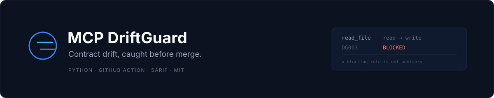
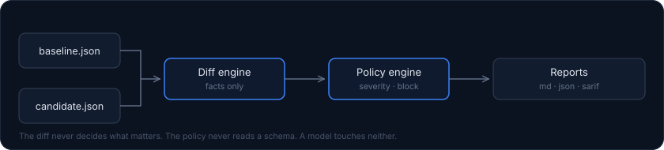

<p align="center">
  
</p>

<p align="center">
  <a href="https://github.com/Reda3D/MCP-DriftGuard/actions/workflows/ci.yml"></a>
  
  
  <a href="https://github.com/Reda3D/MCP-DriftGuard/releases"></a>
</p>

<p align="center">
  <b>Contract-drift monitoring for MCP servers and AI connectors.</b><br>
  <sub>Deterministic, offline, and reproducible byte for byte.</sub>
</p>

---

DriftGuard compares a trusted baseline of what an MCP server declares — its
tools, input parameters and capabilities — against a proposed update, and tells
you exactly what changed, in which direction, and whether your policy allows it.

No model is consulted. No network call is made. The same inputs always produce
byte-identical reports.

```
$ driftguard check --baseline baseline.json --candidate candidate.json --policy driftguard.yml

Result: FAIL — 12 finding(s), fail threshold HIGH

CRITICAL  delete_file  capability_added     filesystem     DG003 (blocking)
CRITICAL  read_file    capability_escalated accesses_secrets DG009 (blocking)
HIGH      read_file    schema_constraint_loosened  /properties/path/minLength  DG005
HIGH      read_file    suspicious_description      DG-H002      DG006
```

---

## Why

An MCP server you trusted yesterday can ship a new version today that adds a
tool, loosens a schema, or grants itself filesystem delete. Nothing in a normal
review surfaces that: the diff is a JSON blob, the schema is nested, and the
dangerous part is often a single boolean flipping from `false` to `true`.

DriftGuard turns that into a reviewable, policy-checked verdict.

What makes it different from a generic AI-security scanner:

- It reasons about **contract drift**, not about prompts or model behaviour.
- The engine is **deterministic**. Severity comes from a version-controlled
  policy file, never from a model's opinion.
- It is **offline by default**. Static analysis only; it never executes an
  untrusted MCP server.
- It **fails closed**. A policy that cannot be parsed stops the build instead of
  silently matching nothing.

## Quick start

```bash
pip install mcp-driftguard

# Compare two snapshots and print a Markdown report
driftguard check --baseline examples/baseline.json --candidate examples/candidate.json

# With a policy, and machine-readable outputs
driftguard check \
  --baseline examples/baseline.json \
  --candidate examples/candidate.json \
  --policy examples/driftguard.yml \
  --output report.md --json-out report.json --sarif-out report.sarif
```

Exit code `1` means the policy was violated. `0` means no drift above your
threshold. See [exit codes](#exit-codes).

Generate a starter policy:

```bash
driftguard init --output driftguard.yml
```

## How it works

<p align="center">
  
</p>

The separation is the whole design:

1. **The diff engine produces facts.** "`read_file` gained a property called
   `encoding`." It has no opinion about whether that is bad.
2. **The policy engine produces judgements.** "A new input parameter is
   MEDIUM." It is a pure function of the change and a YAML file.
3. **Reports are a rendering.** They never contain a decision that is not
   already in the policy output.

A model can be added later to *explain* a finding. It cannot change one.

## Snapshot format

A snapshot is a static, versioned description of a server's declared contract.
DriftGuard never generates one by talking to a server.

```json
{
  "schema_version": "1",
  "server": { "name": "filesystem-mcp", "version": "1.0.0" },
  "tools": [
    {
      "name": "read_file",
      "description": "Read a UTF-8 text file from the workspace.",
      "input_schema": {
        "type": "object",
        "properties": { "path": { "type": "string", "minLength": 1 } },
        "required": ["path"],
        "additionalProperties": false
      },
      "capabilities": {
        "read_only": true,
        "destructive": false,
        "network_access": false,
        "filesystem": "read",
        "executes_commands": false,
        "accesses_secrets": false
      }
    }
  ]
}
```

Full specification, including the capability vocabulary and the rules for
canonical hashing: [docs/snapshot-format.md](docs/snapshot-format.md).

## Policy

```yaml
version: 1
fail_on: HIGH

rules:
  - id: DG002
    description: A tool gained destructive capability
    severity: CRITICAL
    action: block
    match:
      change: [capability_escalated, capability_added]
      capability: destructive

  - id: DG005
    description: Input validation was weakened
    severity: HIGH
    match:
      change: [schema_constraint_loosened, schema_additional_properties_enabled]

waivers:
  - rule_id: DG005
    tool: "legacy_*"
    reason: "Tracked in SEC-1234, migration scheduled"
    approved_by: "security-team"
    expires: "2027-01-01"
```

- `action: block` fails the run regardless of `fail_on`.
- **A blocking rule can never be waived.** Exceptions are made by editing the
  policy under review, not by granting a runtime allowance.
- A waiver without a reason, an owner and an expiry date does not load.
- An unknown key or an unknown `change:` value is a **fatal error**, because a
  typo in a security control must not be a silent no-op.

Full reference: [docs/policy-reference.md](docs/policy-reference.md).

## CLI

| Command | Purpose |
|---|---|
| `driftguard check` | Compare two snapshots and evaluate a policy |
| `driftguard validate` | Validate snapshot and policy files |
| `driftguard hash` | Print the canonical digest of a snapshot |
| `driftguard init` | Write a starter policy |
| `driftguard version` | Print the version |

Useful flags for `check`:

| Flag | Effect |
|---|---|
| `--format markdown\|json\|none` | What to write to stdout |
| `--output`, `--json-out`, `--sarif-out` | Write reports to files |
| `--fail-on SEVERITY` | Override the policy threshold |
| `--as-of YYYY-MM-DD` | Pin the date used for waiver expiry |
| `--step-summary` | Append the report to `$GITHUB_STEP_SUMMARY` |
| `--quiet` | Write nothing to stdout |

`--as-of` exists so that a report can be reproduced exactly. Waiver expiry is
the only time-dependent input in the system, and it is made explicit.

## Exit codes

These are a contract; CI pipelines branch on them.

| Code | Meaning |
|---|---|
| `0` | No finding at or above the threshold |
| `1` | A finding at or above the threshold, or a blocking rule fired |
| `2` | The inputs could not be read or are invalid |
| `3` | Fail-closed: a required check could not be completed (invalid policy, unsupported schema version, internal error) |

## GitHub Action

```yaml
name: MCP contract check
on: pull_request

permissions:
  contents: read

jobs:
  driftguard:
    runs-on: ubuntu-latest
    steps:
      - uses: actions/checkout@v7
        with:
          persist-credentials: false

      - uses: Reda3D/MCP-DriftGuard@v1
        with:
          baseline: mcp/baseline.json
          candidate: mcp/candidate.json
          policy: driftguard.yml
          sarif-output: driftguard.sarif
```

The action is a composite that runs the CLI. It installs nothing else, requests
no secrets, and passes every input through the environment rather than through
shell interpolation.

Optional SARIF upload to code scanning:

```yaml
      - uses: github/codeql-action/upload-sarif@v4
        if: always()
        with:
          sarif_file: driftguard.sarif
```

That step needs `security-events: write`; the check itself does not.

Details and hardening notes: [docs/github-action.md](docs/github-action.md).

## Security model

DriftGuard is a security tool, so its own threat model is documented rather
than implied: [docs/threat-model.md](docs/threat-model.md).

In short:

- Snapshots and policies are **untrusted input**. Size, depth and count are
  bounded; `$ref` values that point outside the document are rejected.
- YAML aliases and duplicate keys are **rejected**, which removes the
  billion-laughs family and the "two parsers disagree" bypass.
- Policy matching uses **globs, never user-supplied regex**, so a policy file
  cannot introduce catastrophic backtracking.
- Reports **escape** everything that comes from a snapshot, so a tool name
  cannot reshape the report a reviewer reads.
- Duplicate tool names are a **fatal error**, and visually identical names are
  reported as `tool_name_collision`.
- The analysis path makes **no network calls** and requires **no API key**.

## Non-goals

- **Not a runtime firewall.** DriftGuard reviews a declared contract before it
  is accepted; it does not sit in the request path.
- **Not a vulnerability scanner.** It finds *changes*, not CVEs.
- **Not an MCP client.** It never connects to a server, by design.
- **Not an AI judge.** Any future AI assistance is limited to explaining
  findings that the policy engine already produced.

## Design decisions

The reasoning behind the architecture, including the weaknesses found in the
initial specification and how each was resolved: [docs/DESIGN.md](docs/DESIGN.md).

## Development

```bash
python -m venv .venv
. .venv/bin/activate          # Windows: .venv\Scripts\activate
pip install -e ".[dev]"

pytest
ruff check .
ruff format --check .
```

The suite covers normal cases, malformed input, policy-bypass attempts and
byte-level reproducibility. See [CONTRIBUTING.md](CONTRIBUTING.md).

## Status

Early. The static-analysis engine, policy engine, reports and CLI are
implemented and tested. The Agent Skill and the read-only MCP server described
in the roadmap are **not** implemented yet, and the documentation says so
rather than implying otherwise.

## License

MIT — see [LICENSE](LICENSE).
